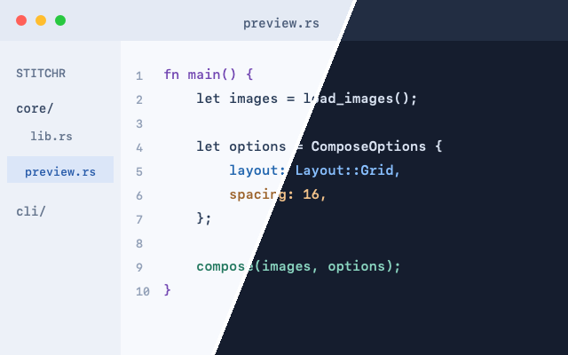

# Stitchr

Combine PNG and JPEG images into grids, stacks, freeform arrangements, or diagonal split comparisons.

Stitchr is a local image-composition CLI for macOS and Linux, built for both people and AI agents. Agents get a machine-readable argument schema, layout inspection before rendering, and versioned JSON results with stable error codes. An **experimental macOS app** is included in this repository.



**Explore:** [Runnable cookbook](docs/examples/README.md) · [Agent usage guide](docs/agents.md) · [Machine-readable examples](docs/examples/cases.json)

## Install the CLI

You need Git, a current stable [Rust toolchain](https://rustup.rs/), and a native C linker. On macOS, install Xcode Command Line Tools with `xcode-select --install`; on Debian/Ubuntu, install `build-essential`.

```sh
cargo install --git https://github.com/igorfil/Stitchr stitchr-cli --locked
stitchr --help
```

Cargo installs `stitchr` into `~/.cargo/bin`; make sure that directory is on your `PATH`. To install from a local checkout instead (for example, to run the cookbook against the included sample images):

```sh
git clone https://github.com/igorfil/Stitchr.git
cd Stitchr
cargo install --path cli --locked
```

## Usage

### Grid

```sh
stitchr img1.png img2.png --layout grid --spacing 10
```

Writes `stitched.png` using two columns, a black background, and 10-pixel gaps and outer margins. Use `--columns` to change the grid width and `--background` to choose an opaque color.

### Horizontal or vertical stack

```sh
stitchr img1.png img2.jpg --layout horizontal --alignment center -o combined.jpg
stitchr img1.png img2.png --layout vertical --spacing 16 --background white -o vertical.png
```

Alignment is `start`, `center`, or `end`. Images keep their original pixel dimensions, after applying EXIF orientation.

### Freeform

```sh
stitchr img1.png img2.png --layout freeform \
  --position 0 0 --position 300 80 -o freeform.png
```

Supply one nonnegative `(X, Y)` position per input. Later images are painted over earlier ones. Spacing and alignment do not apply to freeform layouts.

### Diagonal split

Reproduce the example above using the included [light](docs/examples/light.png) and [dark](docs/examples/dark.png) sample images:

```sh
stitchr docs/examples/light.png docs/examples/dark.png \
  --layout split --divider 4 --background white -o split.png
```

Split inputs must have identical dimensions. The output keeps those dimensions and shows a diagonal slice of each input, in argument order. `--divider` sets the width of the background-colored line between slices.

### Inspect a composition

```sh
stitchr img1.png img2.png --layout grid --print-spec
stitchr --help-json
```

`--print-spec` loads the inputs and prints resolved canvas dimensions and image positions as JSON without writing an image. `--help-json` (also `--schema`) prints the CLI's machine-readable argument specification.

### Use from an agent

Add `--json` to receive versioned success records and actionable error codes on stdout:

```sh
stitchr --json docs/examples/light.png docs/examples/dark.png \
  --layout split --output comparison.png
```

```json
{"format":"png","height":400,"ok":true,"output":"comparison.png","schema_version":1,"width":640}
```

Errors use `{"schema_version":1,"ok":false,"error":{"code":"...","message":"..."}}` and a nonzero exit code. `--json` also wraps spec/schema queries and keeps help and argument errors machine-readable. The [agent guide](docs/agents.md) documents mode combinations, exit codes, recovery, and compatibility rules.

### Output behavior

- The output extension selects PNG (`.png`) or JPEG (`.jpg`, `.jpeg`). Existing output files are overwritten.
- Background colors accept names, `'#RRGGBB'`, and `'rgb(r,g,b)'`; quote colors containing shell metacharacters.
- Output is opaque: transparent input pixels blend onto the selected background.
- The canvas buffer is limited to 512 MiB; oversized compositions return an error. Input images and intermediate buffers require additional memory.

## Experimental macOS app

The app is a working prototype, not a finished desktop release. It supports file import and drag-and-drop, image ordering/removal, live previews, and PNG/JPEG export through the same Rust engine.

| Feature | CLI | macOS app |
| --- | --- | --- |
| Grid and horizontal/vertical stacks | Yes | Yes |
| Freeform coordinates | Yes | Yes |
| Spacing and alignment | Yes | Yes |
| Diagonal split and divider | Yes | Not available |
| Custom background color | Yes | Black only |
| JSON composition/CLI specification | Yes | Not available |

### Build and run

Requires macOS 14 or later, Rust, and a compatible Swift/macOS SDK toolchain. Full Xcode is recommended; some Command Line Tools installations also work. Swift 6 or later is required to run the app tests.

```sh
bash app/build.sh
open target/Stitchr.app
```

The script builds the Rust library, generates Swift bindings, and creates a locally signed app bundle. It selects a compatible installed SDK automatically; set `STITCHR_SDK` to an SDK name or path to select one explicitly.

<details>
<summary>Troubleshooting: linker warnings about missing <code>Developer</code> search paths</summary>

Some Swift 6.4 Command Line Tools builds print `ld: warning: search path '.../CommandLineTools/Developer/...' not found`. Swift's build engine adds these paths, not Stitchr's package settings, and the build still succeeds. A full Xcode toolchain avoids them.

</details>

## Development

The optional Nix development shell provides Cargo, Rust, rustfmt, and Clippy:

```sh
nix develop
```

Run the Rust checks from the repository root:

```sh
cargo fmt --all -- --check
cargo clippy --workspace --all-targets --locked -- -D warnings
cargo test --workspace --locked
```

The workspace tests execute every command in [the cookbook manifest](docs/examples/cases.json), checking dimensions, formats, representative pixels, and checked-in output images.

Build the app and run its preview-scheduling tests with the same selected SDK:

```sh
bash app/build.sh --test
```

GitHub Actions runs the Rust checks on macOS and Linux, plus a macOS app build and test job.

### Repository structure

- **`core/`** — image loading, layout planning, rendering, export, and the UniFFI bridge.
- **`cli/`** — command-line interface and integration tests.
- **`app/`** — experimental SwiftUI app, binding generator, and Swift tests.

## License

Licensed under [BSD-3-Clause](LICENSE).
