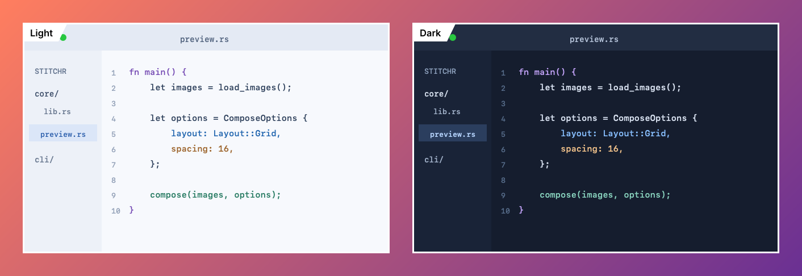

# Stitchr

Combine PNG and JPEG images into grids, stacks, freeform arrangements, or diagonal split comparisons, with solid or gradient backgrounds, borders, and labels.

Stitchr is a local image-composition CLI for macOS and Linux, built for both people and AI agents. Agents get a machine-readable argument schema, layout inspection before rendering, and versioned JSON results with stable error codes. An **experimental macOS app** is included in this repository.



**Explore:** [Examples](examples/README.md) · [Runnable cookbook](docs/examples/README.md) · [Agent usage guide](docs/agents.md) · [Machine-readable examples](docs/examples/cases.json)

## Install the CLI

You need Git, a current stable [Rust toolchain](https://rustup.rs/), and a native C linker. On macOS, install Xcode Command Line Tools with `xcode-select --install`; on Debian/Ubuntu, install `build-essential`.

```sh
cargo install --git https://github.com/igorfil/Stitchr stitchr-cli --locked
stitchr --help
```

Cargo installs `stitchr` into `~/.cargo/bin`; make sure that directory is on your `PATH`. To install from a local checkout instead (for example, to run the examples against the included sample images):

```sh
git clone https://github.com/igorfil/Stitchr.git
cd Stitchr
cargo install --path cli --locked
```

## Usage

```sh
stitchr before.png after.png --layout horizontal --spacing 24 -o combined.png
```

The [examples](examples/README.md) show every option with its command and output image:

| Feature | Options | Examples |
| --- | --- | --- |
| Layouts | `--layout grid\|horizontal\|vertical\|freeform\|split`, `--columns`, `--position` | [Layouts](examples/README.md#1-layouts) |
| Spacing and alignment | `--spacing`, `--alignment`, `--divider` | [Spacing and alignment](examples/README.md#2-spacing-and-alignment) |
| Backgrounds | `--background`, `--background-gradient`, `--gradient-kind`, `--gradient-angle` | [Backgrounds](examples/README.md#3-backgrounds) |
| Borders and labels | `--label`, `--border-width`, `--border-color`, `--label-size` | [Borders and labels](examples/README.md#4-borders-and-labels) |
| Combined recipes | Single image with a title, before/after, labeled grid | [Putting it together](examples/README.md#5-putting-it-together) |
| Output and inspection | `-o file.png\|.jpg`, `--print-spec`, `--json` | [Output and inspection](examples/README.md#6-output-and-inspection) |

Run `stitchr --help` for the full option reference, or `stitchr --help-json` (also `--schema`) for the same reference as JSON.

### Use from an agent

Add `--json` to receive versioned success records and actionable error codes on stdout:

```sh
stitchr --json docs/examples/light.png docs/examples/dark.png \
  --layout split --output comparison.png
```

```json
{"format":"png","height":400,"ok":true,"output":"comparison.png","schema_version":1,"width":640}
```

Errors use `{"schema_version":1,"ok":false,"error":{"code":"...","message":"..."}}` and a nonzero exit code. `--json` also wraps spec/schema queries and keeps help and argument errors machine-readable. The [agent guide](docs/agents.md) documents mode combinations, exit codes, recovery, and compatibility rules.

### Output behavior

- The output extension selects PNG (`.png`) or JPEG (`.jpg`, `.jpeg`). Existing output files are overwritten.
- Images keep their original pixel dimensions, after applying EXIF orientation.
- Colors accept names, `'#RRGGBB'`, and `'rgb(r,g,b)'`; quote colors containing shell metacharacters.
- Output is opaque: transparent input pixels blend onto the selected background.
- The canvas buffer is limited to 512 MiB; oversized compositions return an error. Input images and intermediate buffers require additional memory.

## Experimental macOS app

The app is a working prototype, not a finished desktop release. It supports file import and drag-and-drop, image ordering/removal, live previews, and PNG/JPEG export through the same Rust engine.

| Feature | CLI | macOS app |
| --- | --- | --- |
| Grid and horizontal/vertical stacks | Yes | Yes |
| Freeform coordinates | Yes | Yes |
| Spacing and alignment | Yes | Yes |
| Diagonal split and divider | Yes | Not available |
| Custom background color | Yes | Black only |
| Gradient backgrounds | Yes | Not available |
| Borders and labels | Yes | Not available |
| JSON composition/CLI specification | Yes | Not available |

### Build and run

Requires macOS 14 or later, Rust, and a compatible Swift/macOS SDK toolchain. Full Xcode is recommended; some Command Line Tools installations also work. Swift 6 or later is required to run the app tests.

```sh
bash app/build.sh
open target/Stitchr.app
```

The script builds the Rust library, generates Swift bindings, and creates a locally signed app bundle. It selects a compatible installed SDK automatically; set `STITCHR_SDK` to an SDK name or path to select one explicitly.

<details>
<summary>Troubleshooting: linker warnings about missing <code>Developer</code> search paths</summary>

Some Swift 6.4 Command Line Tools builds print `ld: warning: search path '.../CommandLineTools/Developer/...' not found`. Swift's build engine adds these paths, not Stitchr's package settings, and the build still succeeds. A full Xcode toolchain avoids them.

</details>

## Development

The optional Nix development shell provides Cargo, Rust, rustfmt, and Clippy:

```sh
nix develop
```

Run the Rust checks from the repository root:

```sh
cargo fmt --all -- --check
cargo clippy --workspace --all-targets --locked -- -D warnings
cargo test --workspace --locked
```

The workspace tests execute every command in [the cookbook manifest](docs/examples/cases.json), checking dimensions, formats, representative pixels, and checked-in output images.

Build the app and run its preview-scheduling tests with the same selected SDK:

```sh
bash app/build.sh --test
```

GitHub Actions runs the Rust checks on macOS and Linux, plus a macOS app build and test job.

### Repository structure

- **`core/`** — image loading, layout planning, rendering, export, and the UniFFI bridge.
- **`cli/`** — command-line interface and integration tests.
- **`app/`** — experimental SwiftUI app, binding generator, and Swift tests.

## License

Licensed under [BSD-3-Clause](LICENSE).
