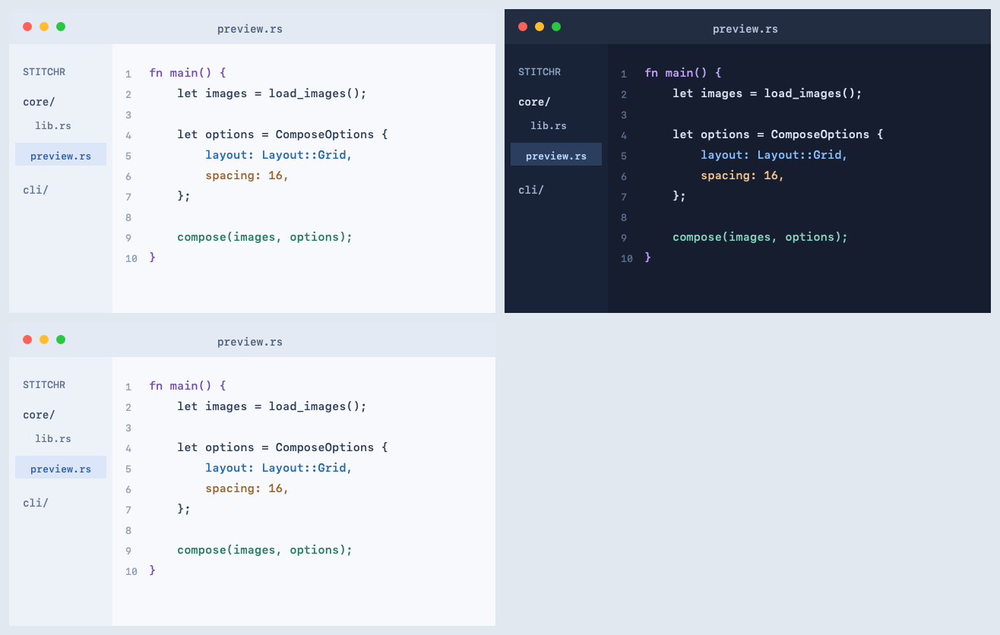
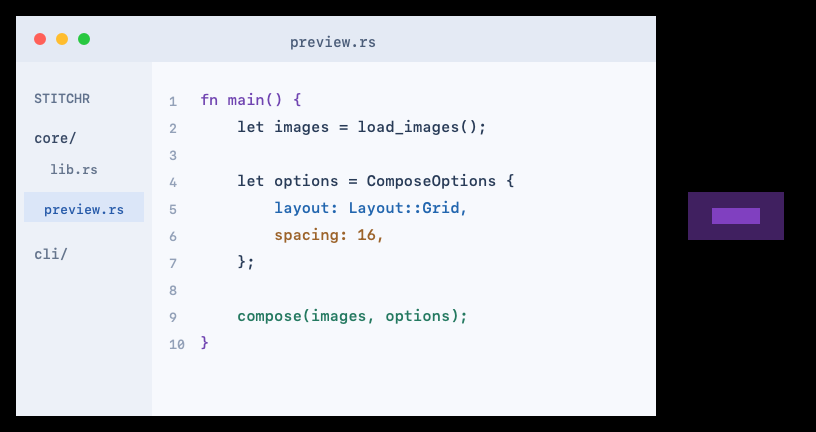
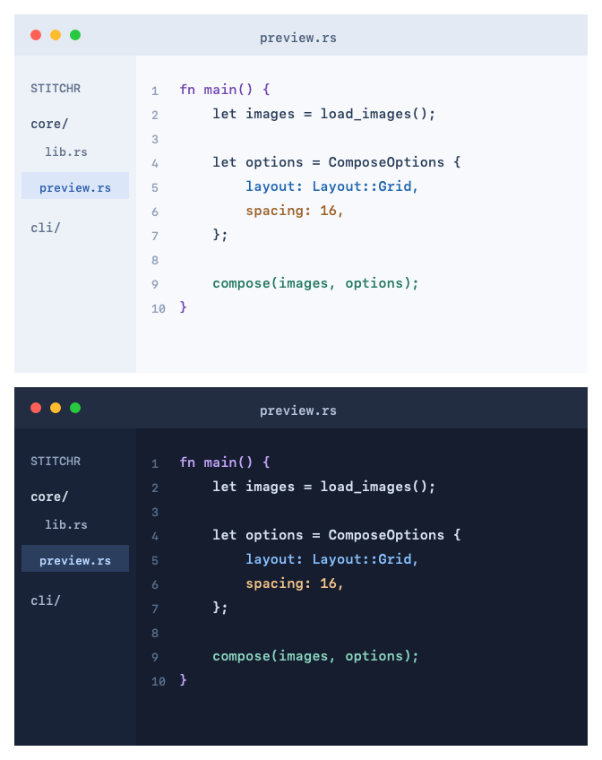
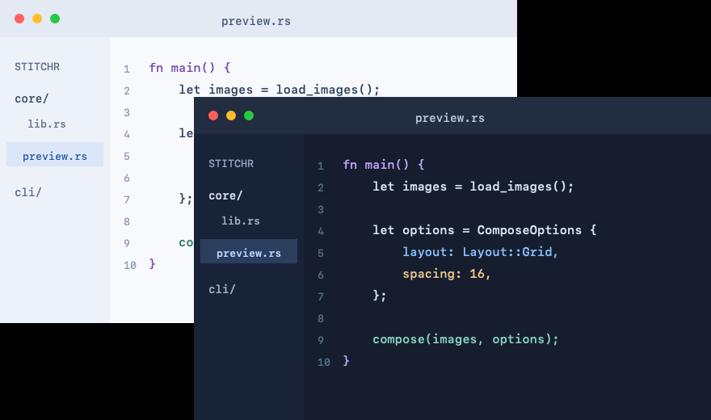
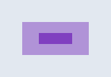
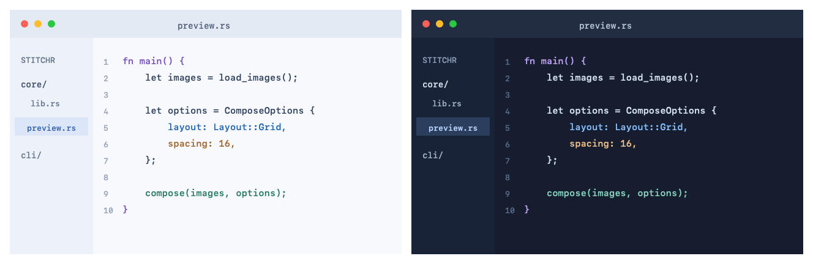

# Stitchr cookbook

Run these commands from the repository root after [installing Stitchr](../../README.md#install-the-cli). Each command writes its result in the current directory and prints a JSON success record. Existing output files are overwritten.

The exact argument arrays, constraints, output metadata, and pixel expectations live in [cases.json](cases.json). CI executes that manifest and checks the reference images below. See the [agent guide](../agents.md) for the JSON protocol and error recovery.

## Inputs

| File | Dimensions | Contents |
| --- | --- | --- |
| [light.png](light.png) | 640 × 400 | Light sample editor image |
| [dark.png](dark.png) | 640 × 400 | Dark sample editor image |
| [overlay.png](overlay.png) | 128 × 80 | Transparent image with translucent and opaque purple regions |

## Grid: three images, two columns

Use a grid for a contact sheet. Positive column counts are required; spacing includes gaps and outer margins. The incomplete final row keeps the chosen background color.

```sh
stitchr --json docs/examples/light.png docs/examples/dark.png docs/examples/light.png \
  --layout grid --columns 2 --spacing 12 --background '#e2e8f0' --output grid.png
```

**Expected:** `grid.png`, PNG, **1316 × 836**.



## Horizontal: center unequal-height images

Center the short overlay beside the full-height screenshot. Horizontal-stack alignment operates on the vertical axis; the black areas include alignment slack and transparent input pixels.

```sh
stitchr --json docs/examples/light.png docs/examples/overlay.png \
  --layout horizontal --alignment center --spacing 16 --output horizontal.png
```

**Expected:** `horizontal.png`, PNG, **816 × 432**.



## Vertical: screenshots with white spacing

Stack screenshots without resizing their pixels. Spacing adds one gap between inputs plus an outer border.

```sh
stitchr --json docs/examples/light.png docs/examples/dark.png \
  --layout vertical --spacing 16 --background white --output vertical.png
```

**Expected:** `vertical.png`, PNG, **672 × 848**.



## Freeform: overlapping screenshots

Supply one nonnegative X/Y pair per input. The dark image is painted second and covers the light image in the overlap. Spacing and alignment do not apply.

```sh
stitchr --json docs/examples/light.png docs/examples/dark.png \
  --layout freeform --position 0 0 --position 240 120 --output freeform.png
```

**Expected:** `freeform.png`, PNG, **880 × 520**.



## Split: light/dark comparison

Split requires same-size inputs and preserves their dimensions. The four-pixel divider uses the background color.

```sh
stitchr --json docs/examples/light.png docs/examples/dark.png \
  --layout split --divider 4 --background white --output split.png
```

**Expected:** `split.png`, PNG, **640 × 400**.


## Background: flatten transparency

Use an opaque custom background to fill a border and blend translucent pixels. Quote the hex color in shell commands; argument-array callers pass it without quotes.

```sh
stitchr --json docs/examples/overlay.png \
  --spacing 16 --background '#e2e8f0' --output background.png
```

**Expected:** `background.png`, opaque PNG, **160 × 112**.



## JPEG: export by extension

Select `.jpg` or `.jpeg` for JPEG output. JSON reports the normalized format as `jpeg`. Compression is lossy, so pixel comparisons need a tolerance.

```sh
stitchr --json docs/examples/light.png docs/examples/dark.png \
  --layout horizontal --spacing 16 --background white --output combined.jpg
```

**Expected:** `combined.jpg`, JPEG, **1328 × 432**.



## Inspect before rendering

Append `--print-spec` to any command above to inspect its resolved layout without writing an image. With `--json`, the result is under `spec`:

```sh
stitchr --json docs/examples/light.png docs/examples/dark.png \
  --layout split --divider 4 --background white --print-spec
```

To run the cookbook's regression checks:

```sh
cargo test -p stitchr-cli --test cookbook --locked
```
