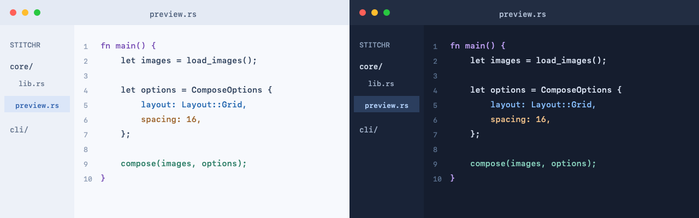
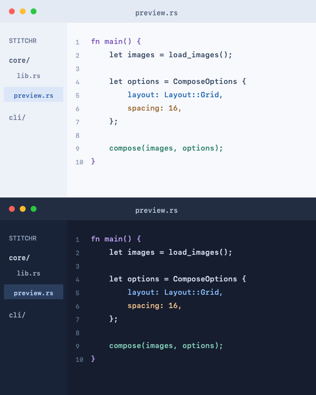
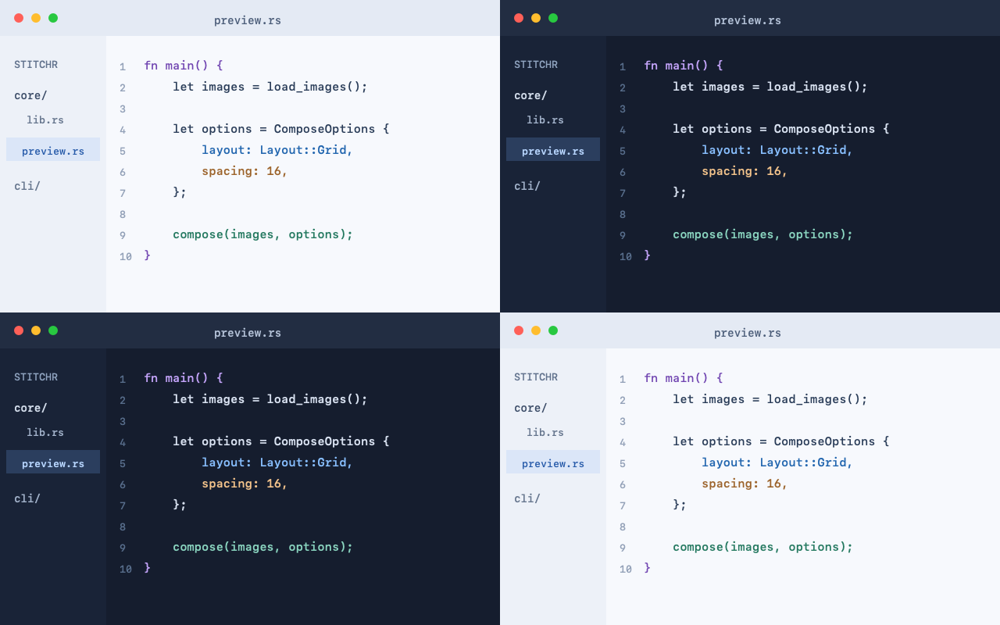
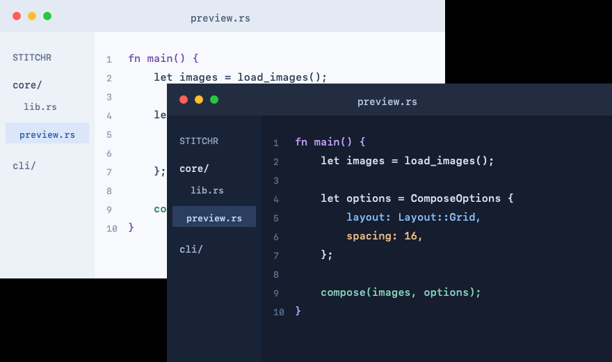
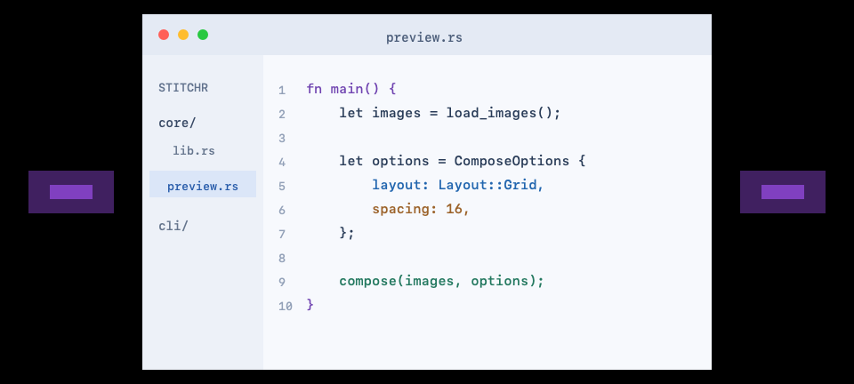
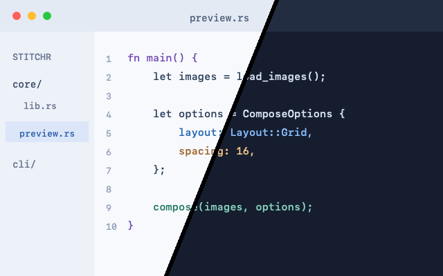
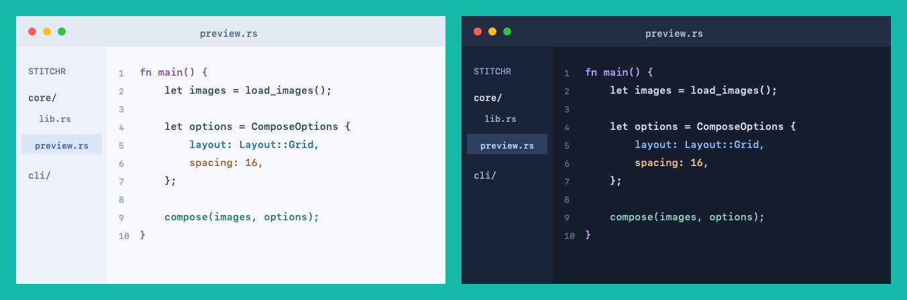
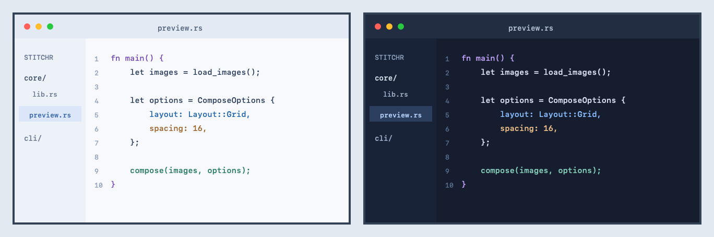
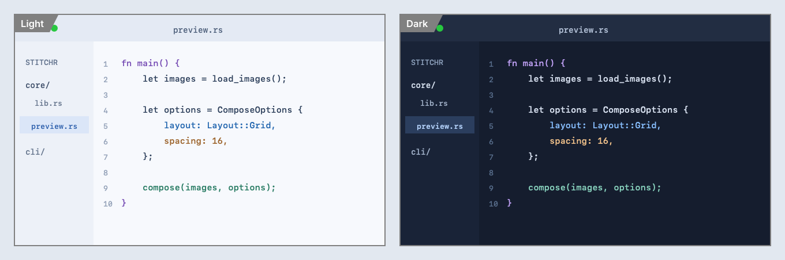
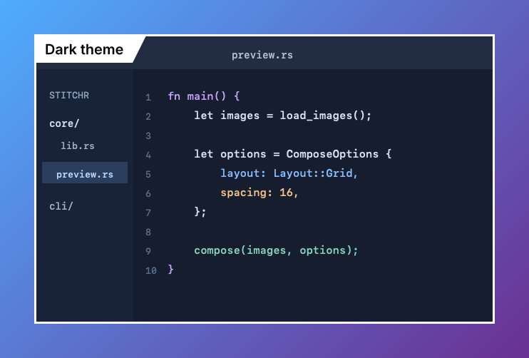

# Stitchr examples

A tour of every Stitchr feature, grouped by what it controls. Each section starts with the simplest form and builds from there.

Run the commands from the repository root after [installing Stitchr](../README.md#install-the-cli). They use the sample images in [`docs/examples/`](../docs/examples):

| File | Size | Contents |
| --- | --- | --- |
| `light.png` | 640 × 400 | Light-theme editor screenshot |
| `dark.png` | 640 × 400 | Dark-theme editor screenshot |
| `overlay.png` | 128 × 80 | Small transparent image with purple regions |

## 1. Layouts

`--layout` decides how images are arranged. Images always keep their original pixel size.

### Horizontal

```sh
stitchr docs/examples/light.png docs/examples/dark.png --layout horizontal \
  -o examples/01-horizontal.png
```



### Vertical

```sh
stitchr docs/examples/light.png docs/examples/dark.png --layout vertical \
  -o examples/02-vertical.png
```



### Grid

Fills rows left to right. `--columns` sets the row length (default 2). `grid` is the default layout.

```sh
stitchr docs/examples/light.png docs/examples/dark.png docs/examples/dark.png docs/examples/light.png \
  --layout grid --columns 2 \
  -o examples/03-grid.png
```



### Freeform

Places each image at an exact `X Y` position, one `--position` per image. Later images are painted over earlier ones.

```sh
stitchr docs/examples/light.png docs/examples/dark.png \
  --layout freeform --position 0 0 --position 240 120 \
  -o examples/04-freeform.png
```



### Diagonal split

Shows a diagonal slice of each image in one frame, in input order. All inputs must be the same size, and the output keeps that size.

```sh
stitchr docs/examples/light.png docs/examples/dark.png --layout split \
  -o examples/05-split.png
```


## 2. Spacing and alignment

### Spacing

`--spacing` adds the same gap between images and around the outside. Works with grid and stack layouts.

```sh
stitchr docs/examples/light.png docs/examples/dark.png --layout horizontal --spacing 24 \
  -o examples/06-spacing.png
```


### Alignment

`--alignment` (`start`, `center`, `end`) positions smaller images within their row or column. In a horizontal stack it acts on the vertical axis.

```sh
stitchr docs/examples/overlay.png docs/examples/light.png docs/examples/overlay.png \
  --layout horizontal --spacing 16 --alignment center \
  -o examples/07-alignment.png
```



### Split divider

`--divider` is the split layout's equivalent of spacing: a line between slices, drawn in the background color.

```sh
stitchr docs/examples/light.png docs/examples/dark.png --layout split --divider 6 \
  -o examples/08-split-divider.png
```



## 3. Backgrounds

The background fills spacing, alignment gaps, and transparent pixels. The default is black.

### Solid color

`--background` accepts color names, `'#RRGGBB'`, and `'rgb(r,g,b)'`.

```sh
stitchr docs/examples/light.png docs/examples/dark.png --layout horizontal --spacing 24 \
  --background '#14b8a6' \
  -o examples/09-background-color.png
```



### Linear gradient

`--background-gradient FROM TO` replaces the solid color. `--gradient-angle` sets the direction in degrees, as in CSS: `0` up, `90` right, `180` down (default).

```sh
stitchr docs/examples/light.png docs/examples/dark.png --layout horizontal --spacing 40 \
  --background-gradient '#ff7e5f' '#6a3093' --gradient-angle 135 \
  -o examples/10-linear-gradient.png
```


### Radial gradient

`--gradient-kind radial` spreads from the center of the canvas to its corners.

```sh
stitchr docs/examples/light.png docs/examples/dark.png --layout vertical --spacing 40 \
  --background-gradient '#e0eafc' '#1e3c72' --gradient-kind radial \
  -o examples/11-radial-gradient.png
```


## 4. Borders and labels

Pass one `--label` per image, in input order. Every image then gets a border, and non-empty labels appear in a tab over the image's top-left corner.

### Borders

An empty label (`--label ""`) draws only the border. `--border-width` and `--border-color` style it.

```sh
stitchr docs/examples/light.png docs/examples/dark.png --layout horizontal --spacing 24 --background '#e2e8f0' \
  --label "" --label "" --border-width 4 --border-color '#334155' \
  -o examples/12-borders.png
```



### Labels

```sh
stitchr docs/examples/light.png docs/examples/dark.png --layout horizontal --spacing 24 --background '#e2e8f0' \
  --label Light --label Dark \
  -o examples/13-labels.png
```



### Label style

`--label-size` sets the font size in pixels (default 20). The text turns black or white to contrast with the border color.

```sh
stitchr docs/examples/light.png docs/examples/dark.png --layout horizontal --spacing 24 --background '#e2e8f0' \
  --label Before --label After --label-size 32 --border-width 4 --border-color '#0ea5e9' \
  -o examples/14-label-style.png
```


### Labeled split

A split gets one border around the whole image, with each label at the top of its slice.

```sh
stitchr docs/examples/light.png docs/examples/dark.png --layout split --divider 4 --background white \
  --label Light --label Dark --border-color '#1e293b' \
  -o examples/15-labeled-split.png
```


## 5. Putting it together

### Single image

Stitchr works on one image too: spacing becomes a margin, so you can give a screenshot a background, a border, and a title.

```sh
stitchr docs/examples/dark.png --spacing 48 \
  --background-gradient '#4facfe' '#6a3093' --gradient-angle 135 \
  --label "Dark theme" --label-size 24 --border-width 3 --border-color white \
  -o examples/16-single-image.png
```



### Before and after

```sh
stitchr docs/examples/light.png docs/examples/dark.png --layout horizontal --spacing 40 \
  --background-gradient '#ff7e5f' '#6a3093' --gradient-angle 135 \
  --label Light --label Dark --border-color white --border-width 3 \
  -o examples/17-before-after.png
```


### Labeled grid

```sh
stitchr docs/examples/light.png docs/examples/dark.png docs/examples/dark.png docs/examples/light.png \
  --layout grid --columns 2 --spacing 32 \
  --background-gradient '#4facfe' '#6a3093' --gradient-angle 120 \
  --label "Light · v1" --label "Dark · v1" --label "Dark · v2" --label "Light · v2" \
  --label-size 22 --border-width 3 --border-color white \
  -o examples/18-labeled-grid.png
```


## 6. Output and inspection

### JPEG

The output extension picks the format: `.png`, `.jpg`, or `.jpeg`. Use `--jpeg-quality` (1-100, default 75) to trade file size for quality.

```sh
stitchr docs/examples/light.png docs/examples/dark.png --layout horizontal --spacing 24 --background '#14b8a6' \
  -o examples/19-jpeg.jpg
```


### Inspect before rendering

`--print-spec` prints the canvas size and each image's position without writing a file. `--json` wraps it in a single-line, versioned result for scripts and AI agents.

```sh
stitchr --json docs/examples/light.png docs/examples/dark.png --layout horizontal --spacing 24 \
  --label Light --label Dark --print-spec
```

```json
{"ok":true,"schema_version":1,"spec":{"background_color":{"blue":0,"green":0,"red":0},"frame":{"border_color":{"blue":128,"green":128,"red":128},"border_width":2,"label_size":20,"labels":["Light","Dark"]},"height":452,"images":[{"name":"light.png","position":{"x":26,"y":26}},{"name":"dark.png","position":{"x":694,"y":26}}],"layout":{"alignment":"start","direction":"horizontal","spacing":24,"type":"stack"},"schema_version":1,"width":1360}}
```

`stitchr --help-json` lists every option in machine-readable form. The [agent guide](../docs/agents.md) covers JSON results and error codes.

## Regenerating these images

Run `examples/generate.sh` from the repository root. Set `STITCHR` to use a specific binary, for example `STITCHR=target/release/stitchr`.
