# Stitchr examples

A step-by-step tour of every Stitchr feature, from the simplest command to a fully styled composition. Each example adds one idea to the ones before it.

Run the commands from the repository root after [installing Stitchr](../README.md#install-the-cli). They use the sample images in [`docs/examples/`](../docs/examples):

| File | Size | Contents |
| --- | --- | --- |
| `light.png` | 640 × 400 | Light-theme editor screenshot |
| `dark.png` | 640 × 400 | Dark-theme editor screenshot |
| `overlay.png` | 128 × 80 | Small transparent image with purple regions |

## Layouts

### 1. Side by side

The simplest composition: put two images next to each other. Images keep their original pixel size.

```sh
stitchr docs/examples/light.png docs/examples/dark.png --layout horizontal \
  -o examples/01-side-by-side.png
```


### 2. Spacing

`--spacing` adds a gap between images and the same margin around the outside. The default background is black.

```sh
stitchr docs/examples/light.png docs/examples/dark.png --layout horizontal --spacing 24 \
  -o examples/02-spacing.png
```

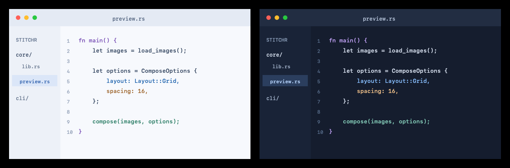

### 3. Background color

`--background` sets the color of the gaps and margins. It accepts color names, `'#RRGGBB'`, and `'rgb(r,g,b)'`.

```sh
stitchr docs/examples/light.png docs/examples/dark.png --layout horizontal --spacing 24 --background white \
  -o examples/03-background-color.png
```

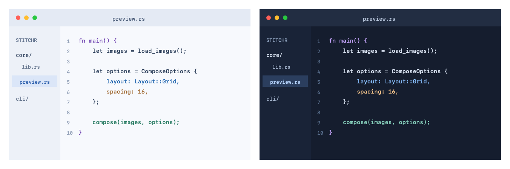

### 4. Vertical stack

`--layout vertical` stacks images top to bottom instead.

```sh
stitchr docs/examples/light.png docs/examples/dark.png --layout vertical --spacing 24 --background white \
  -o examples/04-vertical.png
```

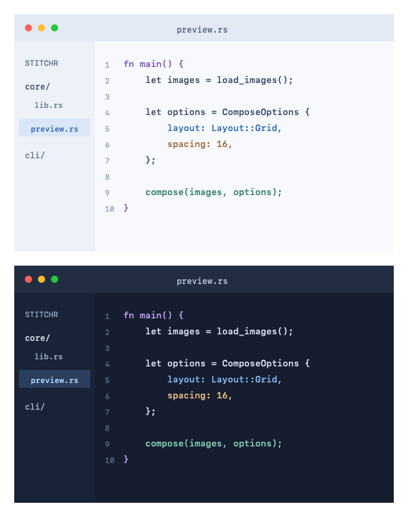

### 5. Grid

`--layout grid` fills rows left to right. `--columns` sets how many images go in each row (the default is 2).

```sh
stitchr docs/examples/light.png docs/examples/dark.png docs/examples/dark.png docs/examples/light.png \
  --layout grid --columns 2 --spacing 16 --background '#e2e8f0' \
  -o examples/05-grid.png
```

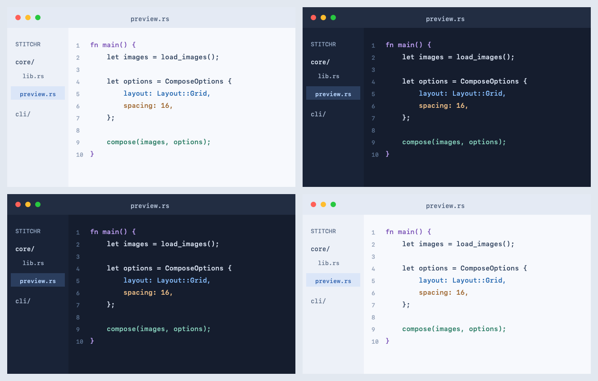

### 6. Alignment

When images have different sizes, `--alignment` decides where smaller ones sit: `start`, `center`, or `end`. In a horizontal stack it works on the vertical axis. Transparent pixels show the background.

```sh
stitchr docs/examples/overlay.png docs/examples/light.png docs/examples/overlay.png \
  --layout horizontal --alignment center --spacing 16 --background '#e2e8f0' \
  -o examples/06-alignment.png
```

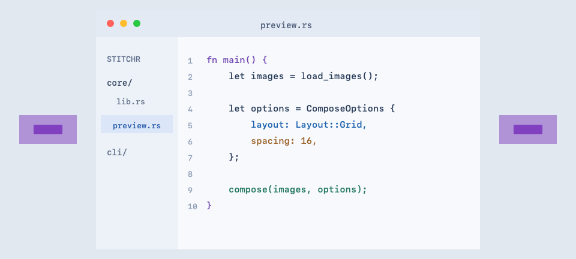

### 7. Freeform

`--layout freeform` places each image at an exact `X Y` position, one `--position` per image. Later images are painted on top of earlier ones, so they can overlap.

```sh
stitchr docs/examples/light.png docs/examples/dark.png \
  --layout freeform --position 0 0 --position 240 120 --background white \
  -o examples/07-freeform.png
```

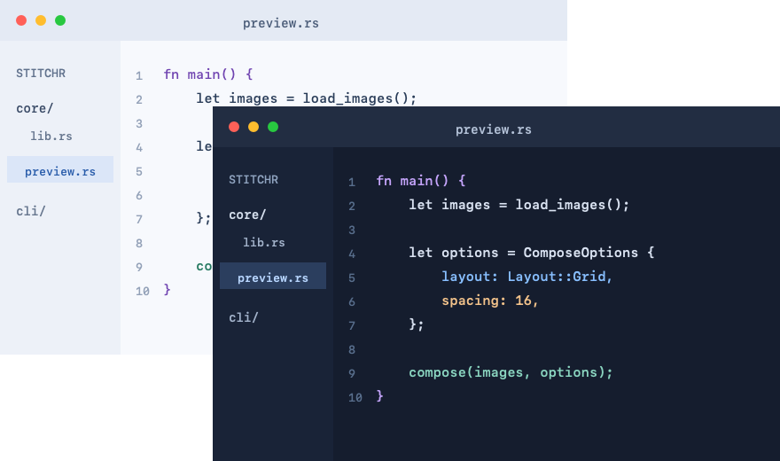

### 8. Diagonal split

`--layout split` shows a diagonal slice of each image in one frame, which is useful for before/after or light/dark comparisons. All inputs must be the same size, and the output keeps that size.

```sh
stitchr docs/examples/light.png docs/examples/dark.png --layout split \
  -o examples/08-split.png
```

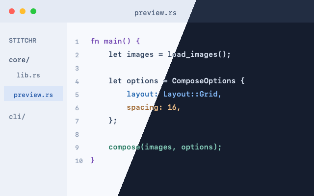

### 9. Split divider

`--divider` draws a line between the slices in the background color.

```sh
stitchr docs/examples/light.png docs/examples/dark.png --layout split --divider 6 --background white \
  -o examples/09-split-divider.png
```

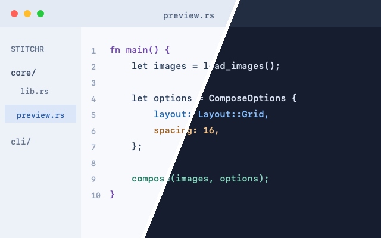

## Backgrounds

### 10. Linear gradient

`--background-gradient FROM TO` replaces the solid background with a two-color gradient. `--gradient-angle` sets its direction in degrees, like CSS: `0` points up, `90` right, `180` down (the default).

```sh
stitchr docs/examples/light.png docs/examples/dark.png --layout horizontal --spacing 40 \
  --background-gradient '#ff7e5f' '#6a3093' --gradient-angle 135 \
  -o examples/10-linear-gradient.png
```

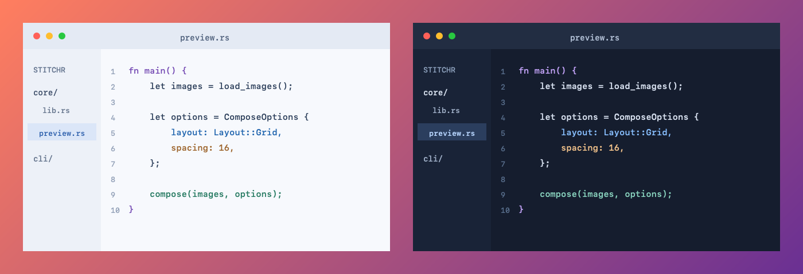

### 11. Radial gradient

`--gradient-kind radial` spreads the gradient outward from the center of the canvas to its corners.

```sh
stitchr docs/examples/light.png docs/examples/dark.png --layout vertical --spacing 40 \
  --background-gradient '#e0eafc' '#1e3c72' --gradient-kind radial \
  -o examples/11-radial-gradient.png
```

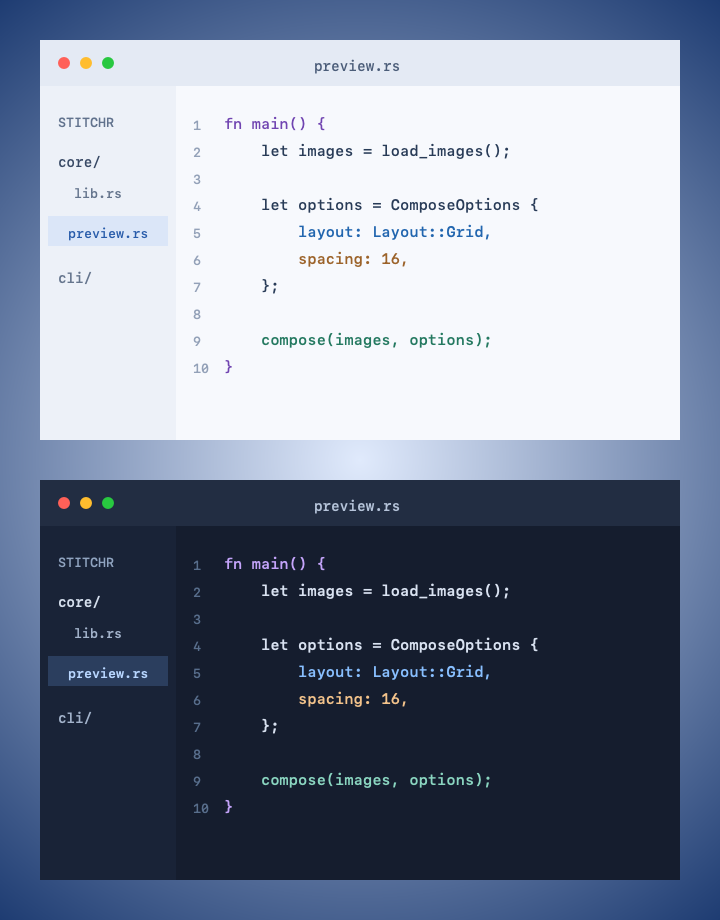

## Borders and labels

### 12. Labels

Give one `--label` per image, in the same order as the inputs. Each image gets a border, and its label appears in a tab on top of the image's top-left corner.

```sh
stitchr docs/examples/light.png docs/examples/dark.png --layout horizontal --spacing 40 \
  --background-gradient '#ff7e5f' '#6a3093' --gradient-angle 135 \
  --label Light --label Dark --border-color white --border-width 3 \
  -o examples/12-labels-on-gradient.png
```

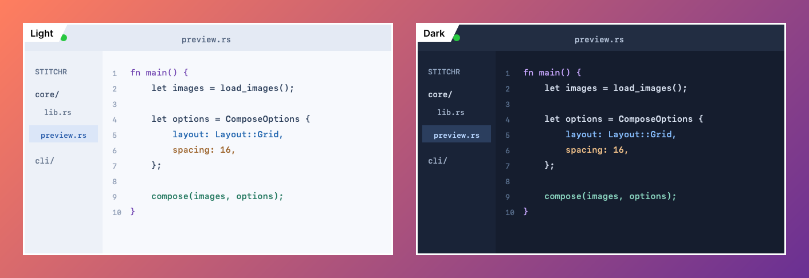

### 13. Borders only

Use an empty label (`--label ""`) to draw just the border. `--border-width` and `--border-color` style it.

```sh
stitchr docs/examples/light.png docs/examples/dark.png --layout horizontal --spacing 24 --background white \
  --label "" --label "" --border-width 4 --border-color '#334155' \
  -o examples/13-borders-only.png
```

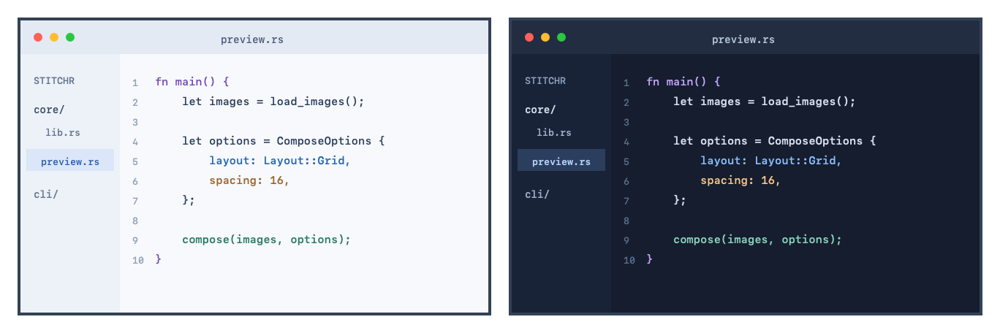

### 14. Label size

`--label-size` sets the font size in pixels (the default is 20). The label text switches between black and white automatically to stay readable on the border color.

```sh
stitchr docs/examples/light.png docs/examples/dark.png --layout horizontal --spacing 24 --background white \
  --label Before --label After --label-size 32 --border-width 4 --border-color '#0ea5e9' \
  -o examples/14-label-size.png
```

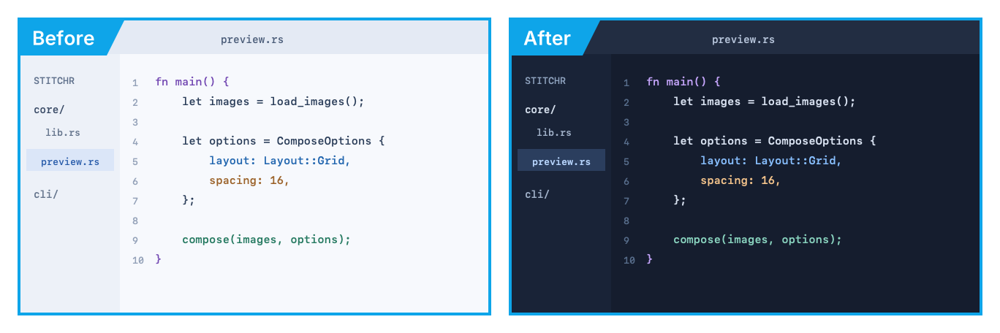

### 15. Labeled split

In a split, one border goes around the whole image, and each label sits at the top of its own slice.

```sh
stitchr docs/examples/light.png docs/examples/dark.png --layout split --divider 4 --background white \
  --label Light --label Dark --border-color '#1e293b' \
  -o examples/15-labeled-split.png
```

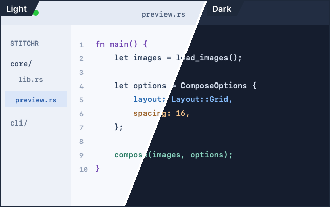

### 16. Everything together

A grid, a gradient, and styled labels in one command.

```sh
stitchr docs/examples/light.png docs/examples/dark.png docs/examples/dark.png docs/examples/light.png \
  --layout grid --columns 2 --spacing 32 \
  --background-gradient '#4facfe' '#6a3093' --gradient-angle 120 \
  --label "Light · v1" --label "Dark · v1" --label "Dark · v2" --label "Light · v2" \
  --label-size 22 --border-width 3 --border-color white \
  -o examples/16-everything-together.png
```

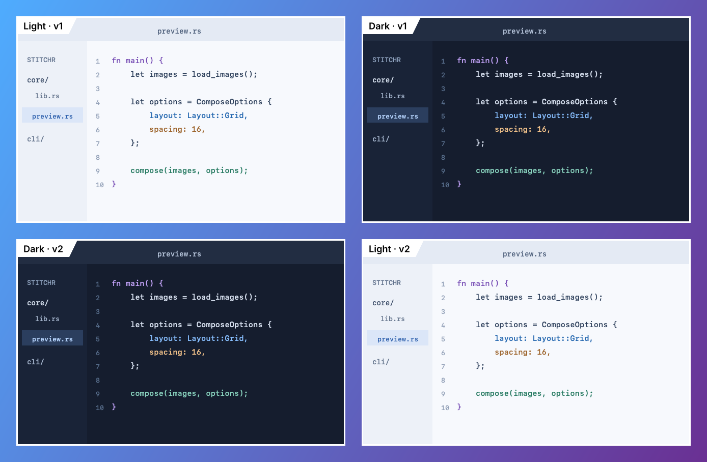

## Output and inspection

### 17. JPEG output

The output file extension picks the format: `.png`, `.jpg`, or `.jpeg`. JPEG files are smaller but lossy.

```sh
stitchr docs/examples/light.png docs/examples/dark.png --layout horizontal --spacing 24 --background white \
  -o examples/17-jpeg.jpg
```

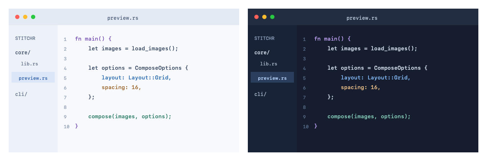

### 18. Inspect before rendering

`--print-spec` shows the final canvas size and where each image will go, without writing a file. Add `--json` for a single-line, versioned result that scripts and AI agents can parse.

```sh
stitchr --json docs/examples/light.png docs/examples/dark.png --layout horizontal --spacing 24 \
  --label Light --label Dark --print-spec
```

```json
{"ok":true,"schema_version":1,"spec":{"background_color":{"blue":0,"green":0,"red":0},"frame":{"border_color":{"blue":128,"green":128,"red":128},"border_width":2,"label_size":20,"labels":["Light","Dark"]},"height":452,"images":[{"name":"light.png","position":{"x":26,"y":26}},{"name":"dark.png","position":{"x":694,"y":26}}],"layout":{"alignment":"start","direction":"horizontal","spacing":24,"type":"stack"},"schema_version":1,"width":1360}}
```

Run `stitchr --help-json` to get the full list of options in machine-readable form. The [agent guide](../docs/agents.md) explains the JSON results and error codes.

## Regenerating these images

To regenerate every image on this page, run `examples/generate.sh` from the repository root (set `STITCHR` to use a specific binary, for example `STITCHR=target/release/stitchr`).
